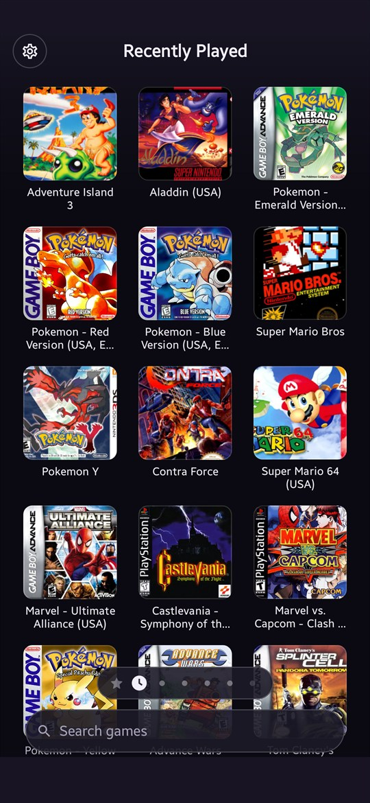
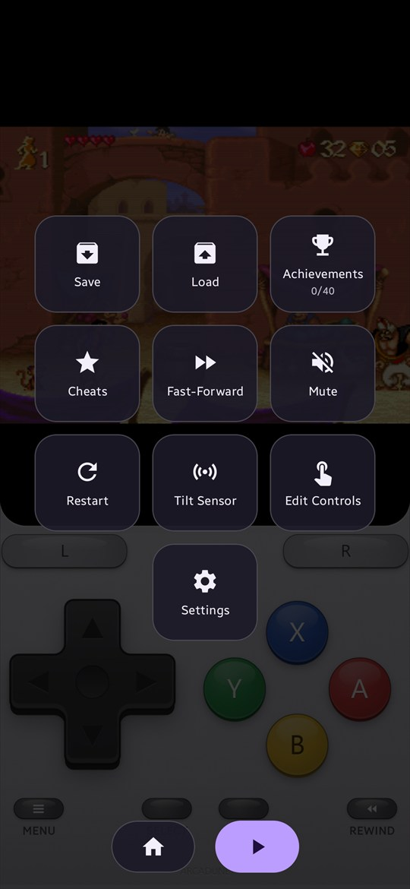
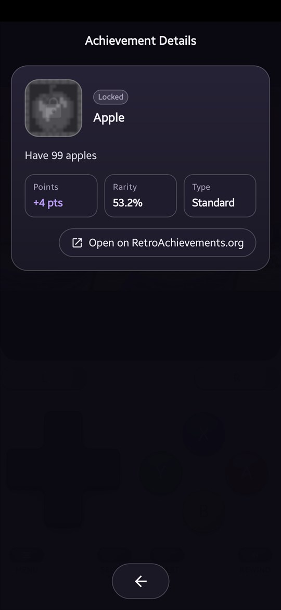

# Arcadune

Arcadune is an open-source multi-system retro game emulator for Android built on Libretro. It combines console-authentic controller skins, native RetroAchievements, portable save management, and a fast glassmorphic interface that works out of the box.

<p align="center">
  
  
  
  
</p>

<p align="center"><sub>The library, followed by Super Nintendo, Nintendo 64, and Nintendo DS console skins.</sub></p>

<p align="center">
  
  
  
  
</p>

<p align="center"><sub>In-game menu, live RetroAchievements browser, tap-to-inspect trophy details, and the Saves &amp; backups manager.</sub></p>

## Download

**[Download Arcadune (Lite)](https://github.com/shahrukhmaniyar/Arcadune/releases/latest/download/Arcadune.apk)** (about 13 MB) — Downloads each console's emulator core automatically the first time you launch a game for that system, then plays offline.

**[Download Arcadune (Full)](https://github.com/shahrukhmaniyar/Arcadune/releases/latest/download/Arcadune-full.apk)** (about 101 MB) — Every emulator core is bundled inside the APK, so it works completely offline from the start.

Both editions share the same package ID (`io.github.shahrukhmaniyar.arcadune`), so you can install either one on top of the other without losing your library, saves, or settings. All releases are available on the [Releases page](https://github.com/shahrukhmaniyar/Arcadune/releases). Arcadune requires Android 6.0 or newer and includes built-in update checks under **Settings > Updates**.

## Highlights

- **Native RetroAchievements (`rcheevos`):** Sign in once under **Settings > RetroAchievements** (with Android Autofill support) to track trophies across NES, SNES, Game Boy, GBA, N64, DS, PlayStation, PSP, Sega consoles, PC Engine, Arcade, and more. Includes non-intrusive glassmorphic unlock popups with a synthesized **Unlock Chime** and **tactile haptic celebration**, live progress & active-challenge indicators, offline unlock queueing, Rich Presence, and an in-game **Achievements** browser with tap-to-inspect trophy details (`Points`, `Rarity`, `Missable` / `Progression` / `Win` tags).
- **Saves & Backups Manager:** Manage your progress directly from **Settings > Saves & backups** — inspect storage usage across in-game saves and save states, export all raw save files (`.srm`, memory cards, PSP/3DS saves) to a visible folder (`Documents`, `Downloads`, or SD card), export or import individual `.srm` game saves, or back up and restore everything (saves + crisp `256dp` save states) as a single `.zip` archive.
- **A Controller Made for Every Console:** Each system features its own sculpted controller skin in console-accurate colors (PlayStation, N64, DS, 3DS, SNES, NES, Game Boy, GBA, Sega, PSP, and more), plus a clean Minimal skin option. Games render through rounded viewport cutouts in portrait and adapt seamlessly in landscape.
- **Full Controller Layout Editor:** Move and resize individual buttons, adjust controller opacity, and reset layouts independently for each console and orientation (**Game Menu > Edit Controls** or **Settings > Controllers**).
- **Nintendo DS & 3DS Dual-Screen Support:** Features an enlarged primary display with a companion secondary screen in landscape, a dedicated **Swap** button to trade screens instantly, multi-touch DS touchscreen input while holding buttons, always-ready DS microphone support, and dedicated 3DS resolution/layout options.
- **Glassmorphic In-Game Menu & Per-Game Settings:** Configure shaders (`Auto`, `Sharp`, `Smooth`, `CRT`, `LCD`), fast-forward speed (`2x`–`8x`), tilt sensor mappings, audio mute, and core variables globally for a console or **only for a single game**.
- **Built-in Cheats:** Search and apply cheats from the online Libretro cheat database matched by game title, or add custom cheat codes directly from the pause menu.
- **Smart Library & Cover Manager:** Swipe smoothly across Favorites, Recently Played, and console pages with low memory usage and instant prefix search. Automatically fetches regional box art from the `libretro-thumbnails` mirror, lets you search Google Images with an editable query on long-press, re-fetches covers when you rename a game, and includes a batch **Cover Manager** for missing artwork.
- **30-Second Rewind:** Hold the **Rewind** button to step backward up to 30 seconds in real time on supported classic consoles.
- **Theme Colors & In-App Updates:** Customize the interface with **Violet**, **Teal**, **Blue**, **Mint**, or **Amber** accents, and check, download (SHA-256 verified), and install new Arcadune releases without leaving the app.

### Supported Systems

- Atari 2600 (A26) ([stella](https://docs.libretro.com/library/stella/))
- Atari 7800 (A78) ([prosystem](https://docs.libretro.com/library/prosystem/))
- Atari Lynx (Lynx) ([handy](https://docs.libretro.com/library/handy/))
- Nintendo (NES) ([fceumm](https://docs.libretro.com/library/fceumm/))
- Super Nintendo (SNES) ([snes9x](https://docs.libretro.com/library/snes9x/))
- Game Boy (GB) ([gambatte](https://docs.libretro.com/library/gambatte/))
- Game Boy Color (GBC) ([gambatte](https://docs.libretro.com/library/gambatte/))
- Game Boy Advance (GBA) ([mgba](https://docs.libretro.com/library/mgba/))
- Sega Genesis / Mega Drive ([genesis_plus_gx](https://docs.libretro.com/library/genesis_plus_gx/))
- Sega CD / Mega CD ([genesis_plus_gx](https://docs.libretro.com/library/genesis_plus_gx/))
- Sega Master System (SMS) ([genesis_plus_gx](https://docs.libretro.com/library/genesis_plus_gx/))
- Sega Game Gear (GG) ([genesis_plus_gx](https://docs.libretro.com/library/genesis_plus_gx/))
- Nintendo 64 (N64) ([mupen64plus](https://docs.libretro.com/library/mupen64plus/))
- PlayStation (PSX) ([PCSX-ReARMed](https://docs.libretro.com/library/pcsx_rearmed/))
- PlayStation Portable (PSP) ([ppsspp](https://docs.libretro.com/library/ppsspp/))
- FinalBurn Neo (Arcade) ([fbneo](https://github.com/libretro/FBNeo/))
- Nintendo DS (NDS) ([MelonDS](https://docs.libretro.com/library/melonds/))
- NEC PC Engine / TurboGrafx-16 (PCE) ([beetle_pce_fast](https://docs.libretro.com/library/beetle_pce_fast/))
- Neo Geo Pocket (NGP) ([mednafen_ngp](https://docs.libretro.com/library/beetle_neopop/))
- Neo Geo Pocket Color (NGC) ([mednafen_ngp](https://docs.libretro.com/library/beetle_neopop/))
- WonderSwan (WS) ([beetle_cygne](https://docs.libretro.com/library/beetle_cygne/))
- WonderSwan Color (WSC) ([beetle_cygne](https://docs.libretro.com/library/beetle_cygne/))
- Nintendo 3DS (3DS) ([citra](https://docs.libretro.com/library/citra/)), 64-bit devices only
- MAME 2003-Plus (Arcade) ([mame2003_plus](https://docs.libretro.com/library/mame_2003_plus/))
- DOS (DOS) ([dosbox_pure](https://docs.libretro.com/library/dosbox_pure/))

### Core Capabilities

- Android phone, tablet, and Android TV (Leanback) support
- Automatic game-state save and resume + manual save-state slots with high-resolution previews
- Zipped ROM scanning and background indexing
- Hardware gamepad bindings, shortcuts, rumble, and local multiplayer
- Display shaders (`LCD`, `CRT`, `Sharp`, `Smooth`)
- Tilt-to-analog / shoulder input sensor support

## Build from Source

Requires **JDK 17**, the **Android SDK**, and **NDK 26.3.11579264** (for compiling `libretrodroid` + `rcheevos`).

```bash
git clone --recurse-submodules https://github.com/shahrukhmaniyar/Arcadune.git
cd Arcadune

# Lite APK (downloads cores on demand)
./gradlew :lemuroid-app:assembleFreeDynamicRelease

# Full APK (all Libretro cores bundled)
./gradlew :lemuroid-app:assembleFreeBundleRelease
```

On Windows, run `powershell -ExecutionPolicy Bypass -File scripts\fix-bundled-cores.ps1` once after cloning before building the full bundled APK.

Controller artwork is procedurally generated by code. After modifying a controller layout, regenerate its assets with `./gradlew -p tools/skin-studio art` (see [tools/skin-studio](tools/skin-studio/README.md)).

## Credits & License

Arcadune is free software released under the [GNU General Public License v3.0](COPYING).

- **Upstream Attribution & Modification Notice (GPLv3 §4–5):** Arcadune is a modified fork (2026, maintained by Shahrukh Maniyar) based on [Lemuroid](https://github.com/Swordfish90/Lemuroid) and [LibretroDroid](https://github.com/Swordfish90/LibretroDroid) by `Swordfish90`, which originated from [Retrograde](https://github.com/retrograde/retrograde-android). Original copyright notices are preserved in the source files.
- **Emulation Cores:** Bundled and downloadable [Libretro](https://www.libretro.com/) cores are distributed under their respective upstream licenses.
- **Achievements Engine:** Native RetroAchievements integration is powered by [rcheevos](https://github.com/RetroAchievements/rcheevos), licensed under the MIT License.
- **Cheat Database:** Cheat codes are sourced from the [libretro-database](https://github.com/libretro/libretro-database), licensed under [CC BY-SA 4.0](https://creativecommons.org/licenses/by-sa/4.0/).
