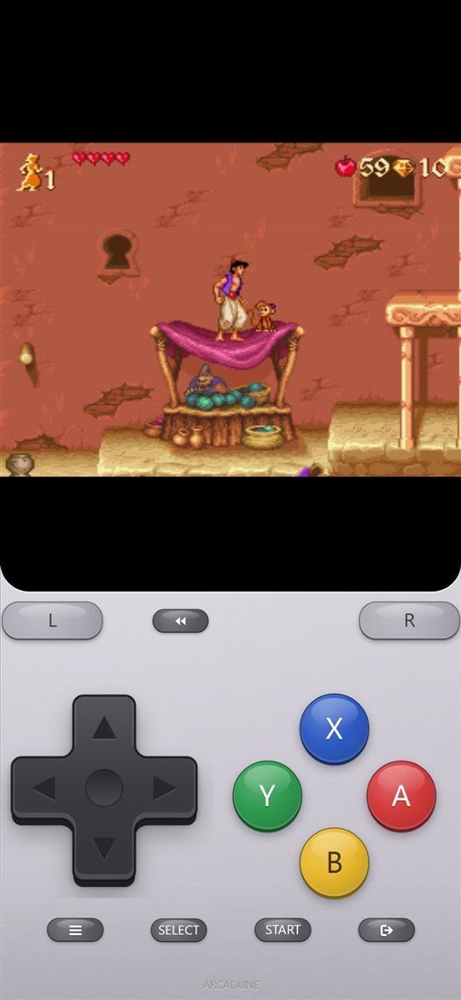
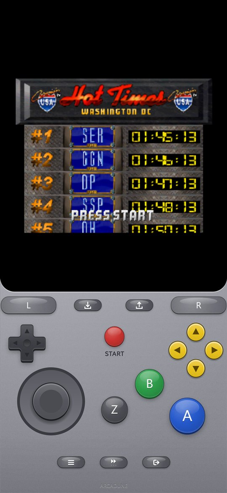
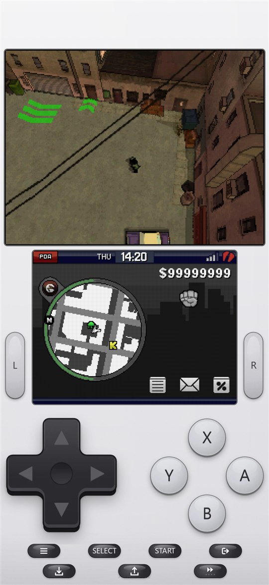
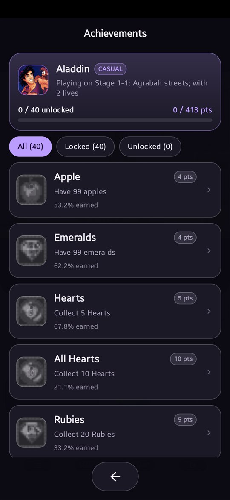
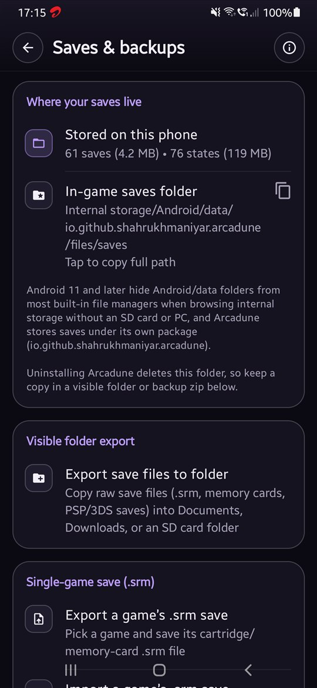

# Arcadune

Arcadune is an open-source multi-system retro game emulator for Android built on Libretro. It combines console-authentic controller skins, 35 emulated systems across 52 Libretro cores, native RetroAchievements, portable save management, and a fast glassmorphic interface that works out of the box.

<p align="center">
  
  
  
  
</p>

<p align="center"><sub>The library, followed by Super Nintendo, Nintendo 64, and Nintendo DS console skins.</sub></p>

<p align="center">
  
  
  
  
</p>

<p align="center"><sub>In-game menu, live RetroAchievements browser, tap-to-inspect trophy details, and the Saves &amp; backups manager.</sub></p>

## Download

**[Download Arcadune (Lite)](https://github.com/shahrukhmaniyar/Arcadune/releases/latest/download/Arcadune.apk)** (about 13 MB) — Downloads each console's emulator core automatically from Arcadune's GitHub Releases the first time you launch a game for that system, then plays offline.

**[Download Arcadune (Full)](https://github.com/shahrukhmaniyar/Arcadune/releases/latest/download/Arcadune-full.apk)** (about 124 MB) — Bundles all 29 default emulator cores inside the APK so every supported console works 100% offline from the start, while keeping 23 optional alternative cores available as lightweight on-demand downloads under **Settings > Change Cores**.

Both editions share the same package ID (`io.github.shahrukhmaniyar.arcadune`), so you can install either one on top of the other without losing your library, saves, or settings. All releases are available on the [Releases page](https://github.com/shahrukhmaniyar/Arcadune/releases). Arcadune requires Android 6.0 or newer and includes built-in update checks under **Settings > Updates**.

## What's New in 1.1.0

- **Ten new systems** (35 in total, 52 cores): Dreamcast, Saturn, 32X, 3DO, Atari 5200, Atari 8-bit, ColecoVision, C64, Apple II and MSX.
- **RetroAchievements** with a live in-game browser, offline unlock queue and encrypted sign-in. Hardcore Mode is built and tested but stays locked in public builds until RetroAchievements approves Arcadune ([compliance review](docs/HARDCORE_COMPLIANCE_REVIEW.md)).
- **Saves & backups manager** and per-game play time.
- **Faster fast-forward** (2x to 8x) on every console, including the DS, and a much quicker exit from a game.
- **Rebuilt controller layouts:** Exit is always on the controller, every console's buttons were arranged by hand with equal sizes and gaps, and the DS and 3DS have new defaults that adapt to your phone's shape.
- **Fixes:** 3DO (and Dreamcast) touch buttons now work, and gamepad shortcuts for Quick Save, Quick Load and Fast-Forward can be set in Settings.

The full list is in the [1.1.0 release notes](docs/RELEASE_NOTES_1.1.0.md).

## Highlights

- **Native RetroAchievements (`rcheevos 12.5`):** Sign in once under **Settings > RetroAchievements** (with Android Autofill and hardware-backed Android Keystore `AES-256-GCM` token protection) to track trophies across NES/FDS, SNES, Game Boy, GBA, N64, DS, PlayStation, PSP, Dreamcast, Saturn, 3DO, Sega consoles, PC Engine, Arcade, ColecoVision, C64, Apple II, MSX, and more. Includes non-intrusive glassmorphic unlock popups with a synthesized **Unlock Chime** and **tactile haptic celebration**, live progress & active-challenge indicators, durable offline unlock & leaderboard queueing, Rich Presence, and an in-game **Achievements** browser with tap-to-inspect trophy details (`Points`, `Rarity`, `Missable` / `Progression` / `Win` tags).
- **29 Built-In Default Cores + 23 On-Demand Alternative Cores:** Every console works immediately with its default core, and **Settings > Change Cores** lets you download alternative cores on demand (such as `armGBA`, `gpSP`, `VBA-M`, `SameBoy`, `Mesen`, `Nestopia UE`, `Beetle Supafaust`, `bsnes`, `SwanStation`, `Beetle PSX`, `Beetle Saturn`, `Azahar`, `DeSmuME`, `ParaLLEl N64`, `BlastEm`, and more) and manage or clear cached downloads anytime.
- **Saves & Backups Manager:** Manage your progress directly from **Settings > Saves & backups** — inspect storage usage across in-game saves and save states, export all raw save files (`.srm`, memory cards, PSP/3DS saves) to a visible folder (`Documents`, `Downloads`, or SD card), export or import individual `.srm` game saves, or back up and restore everything (saves + crisp `256dp` save states) as a single `.zip` archive.
- **A Controller Made for Every Console:** Each system features its own sculpted controller skin in console-accurate colors (PlayStation & DualShock, N64, DS, 3DS, SNES, NES, Game Boy, GBA, Sega Genesis 3/6-button, Saturn & 3D Pad, Dreamcast, 3DO, PSP, C64, MSX, and more), plus a clean Minimal skin option.
- **3-Layer Studio Layout Editor:** Independently move and resize buttons, adjust individual game screens (including independent Top & Bottom screens on DS and 3DS), and drag the Portrait console background (`BG`) height with a live 3-layer stack (`BG` bottom -> `Screen` middle -> `Buttons` top) via **Game Menu > Edit Controls** or **Settings > Controllers**.
- **Glassmorphic In-Game Menu & Per-Game Settings:** Configure shaders (`Auto`, `Sharp`, `Smooth`, `CRT`, `LCD`), fast-forward speed (`2x`–`8x` with progressive speed LED pips), an always-on `EXIT` button plus optional `FAST`, Quick Save and Quick Load buttons, tilt sensor mappings, audio mute, and core variables globally for a console or **only for a single game**.
- **Built-in Cheats:** Search and apply cheats from the online Libretro cheat database matched by game title, or add custom cheat codes directly from the pause menu.
- **Smart Library & Cover Manager:** Swipe smoothly across Favorites, Recently Played, and console pages with low memory usage and instant prefix search. Automatically fetches regional box art from the `libretro-thumbnails` mirror, lets you search Google Images with an editable query on long-press, re-fetches covers when you rename a game, and includes a batch **Cover Manager** for missing artwork.
- **30-Second Rewind:** Hold the **Rewind** button to step backward up to 30 seconds in real time on supported classic consoles.

### Supported Systems (35 Consoles & Home Computers)

| System | Built-In Default Core | On-Demand Alternative Cores (`Settings > Change Cores`) |
|---|---|---|
| **Atari 2600** | `Stella` | `Stella 2014` |
| **Atari 5200** | `a5200` | — |
| **Atari 7800** | `ProSystem` | — |
| **Atari 8-bit (400/800/XL/XE)** | `Atari800` | — |
| **Atari Lynx** | `Handy` | `Gearlynx` |
| **Nintendo (NES / FDS)** | `FCEUmm` | `Mesen`, `Nestopia UE`, `QuickNES` |
| **Super Nintendo (SNES)** | `Snes9x` | `Beetle Supafaust`, `bsnes` |
| **Nintendo 64 (N64)** | `Mupen64Plus-Next` | `ParaLLEl N64` |
| **Game Boy (GB)** | `Gambatte` | `armGBA`, `SameBoy`, `Gearboy`, `VBA-M` |
| **Game Boy Color (GBC)** | `Gambatte` | `armGBA`, `SameBoy`, `Gearboy`, `VBA-M` |
| **Game Boy Advance (GBA)** | `mGBA` | `armGBA`, `gpSP`, `VBA-M`, `Beetle GBA` |
| **Nintendo DS (NDS)** | `melonDS` | `DeSmuME` |
| **Nintendo 3DS (3DS)** *(64-bit ARM)* | `Citra` | `Azahar` |
| **PlayStation (PSX)** | `PCSX-ReARMed` | `SwanStation`, `Beetle PSX` |
| **PlayStation Portable (PSP)** | `PPSSPP` | — |
| **Sega Master System (SMS)** | `Genesis Plus GX` | `Gearsystem`, `PicoDrive` |
| **Sega Game Gear (GG)** | `Genesis Plus GX` | `Gearsystem` |
| **Sega Genesis / Mega Drive** | `Genesis Plus GX` | `BlastEm`, `PicoDrive` |
| **Sega CD / Mega-CD** | `Genesis Plus GX` | `PicoDrive` |
| **Sega 32X** | `PicoDrive` | — |
| **Sega Saturn** | `YabaSanshiro` | `Beetle Saturn` |
| **Sega Dreamcast** | `Flycast` | — |
| **NEC PC Engine / TurboGrafx-16 / CD** | `Beetle PCE Fast` | `Beetle PCE` |
| **3DO Interactive Multiplayer** | `Opera` | — |
| **SNK Neo Geo Pocket & Color** | `Beetle NeoPop` | `RACE` |
| **Bandai WonderSwan & Color** | `Beetle Cygne` | — |
| **ColecoVision** | `Gearcoleco` | — |
| **Commodore 64 (C64)** | `VICE x64` | — |
| **Apple II** | `AppleWin` | — |
| **Microsoft MSX / MSX2** | `fMSX` | — |
| **Arcade (FinalBurn Neo)** | `FBNeo` | — |
| **Arcade (MAME 2003-Plus)** | `MAME 2003-Plus` | — |
| **MS-DOS** | `DOSBox-Pure` | — |

*(Note: GB/GBC, Neo Geo Pocket/Color, and WonderSwan/Color each appear as dedicated console entries in the library, totaling 35 distinct `SystemID` targets.)*

## Build from Source

Requires **JDK 17**, the **Android SDK**, and **NDK 26.3.11579264** (for compiling `libretrodroid` + `rcheevos`).

```bash
git clone --recurse-submodules https://github.com/shahrukhmaniyar/Arcadune.git
cd Arcadune

# Lite APK (downloads cores on demand)
./gradlew :lemuroid-app:assembleFreeDynamicRelease

# Full APK (29 default cores bundled + 23 optional cores downloadable on demand)
./gradlew :lemuroid-app:assembleFreeBundleRelease
```

On Windows, run `powershell -ExecutionPolicy Bypass -File scripts\fix-bundled-cores.ps1` once after cloning before building the full bundled APK.

Controller artwork is procedurally generated by code. After modifying a controller layout, regenerate its assets with `./gradlew -p tools/skin-studio art` (see [tools/skin-studio](tools/skin-studio/README.md)).

## Credits & License

Arcadune is free software released under the [GNU General Public License v3.0](COPYING).

- **Upstream Attribution & Modification Notice (GPLv3 §4–5):** Arcadune is a modified fork (2026, maintained by Shahrukh Maniyar) based on [Lemuroid](https://github.com/Swordfish90/Lemuroid) and [LibretroDroid](https://github.com/Swordfish90/LibretroDroid) by `Swordfish90`, which originated from [Retrograde](https://github.com/retrograde/retrograde-android). Original copyright notices are preserved in the source files.
- **Emulation Cores & Aggregate Distribution Notice (GPLv3 §5):** Bundled and on-demand [Libretro](https://www.libretro.com/) core `.so` binaries are built from source at [shahrukhmaniyar/ArcaduneCores](https://github.com/shahrukhmaniyar/ArcaduneCores) and loaded as separate shared libraries over the standard C Libretro API boundary under their respective upstream FOSS and non-commercial licenses. Every core, its license, and its upstream project URL are listed inside the app (**Settings > Info / About > Emulator Cores & Licenses**) and in [docs/HARDCORE_COMPLIANCE_REVIEW.md](docs/HARDCORE_COMPLIANCE_REVIEW.md).
- **Achievements Engine:** Native RetroAchievements integration is powered by [rcheevos](https://github.com/RetroAchievements/rcheevos), licensed under the MIT License.
- **Cheat Database:** Cheat codes are sourced from the [libretro-database](https://github.com/libretro/libretro-database), licensed under [CC BY-SA 4.0](https://creativecommons.org/licenses/by-sa/4.0/).
- **Privacy:** See [PRIVACY.md](PRIVACY.md) for full details on local storage, optional network endpoints, and credential protection.
